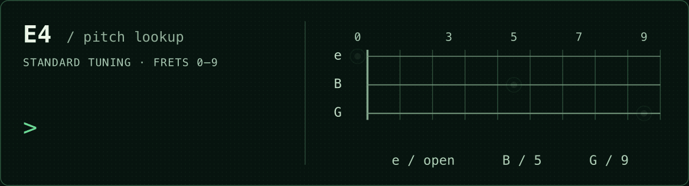

<picture>
  <source media="(prefers-reduced-motion: reduce) and (max-width: 600px)" srcset="./assets/matrix-mobile-still.png">
  <source media="(prefers-reduced-motion: reduce)" srcset="./assets/matrix-still.png">
  <source media="(max-width: 600px)" srcset="./assets/matrix-mobile.svg">
  
</picture>

I’m Ivan, a software developer in Boston with a B.S. in Computer Science from Suffolk University. I build web apps with Django and PostgreSQL. I also write music, and my latest project grew out of a question about turning a guitar recording into something I can play.

[Selected projects](#selected-projects) · [Try the guitar demo](#guitar-transcription) · [LinkedIn](https://www.linkedin.com/in/ivartdev/)

## Selected projects

### NotifAI

I coordinated the four-person university team behind this note-taking app and connected our Flutter client to a Django REST API backed by MongoDB. One piece I worked on was the folder tree. The database stores each folder separately, but the phone needs the whole hierarchy in one response.

[Follow a folder request from Flutter to MongoDB →](projects/notifai.md)

### Sushi Unix Shell

I worked on a Unix shell in C++ for my operating systems course. Even a short command brings the pieces together. The Flex lexer has to keep quoted words together, the Bison parser builds the argument list, and the shell starts a child process to run the program.

[Trace a command from the prompt to a child process →](projects/sushi.md)

### Friday

Friday is my personal Telegram bot for looking up stocks. Send it a ticker and it reads figures from Finviz, puts them into a short report, and keeps a history in SQLite.

## Guitar transcription

I’m experimenting with detecting notes in an isolated guitar recording. Writing playable tablature raises a second question. Once I know the pitch, which string and fret should I choose?

<kbd>RUN</kbd> &nbsp; <strong>Find E4 on the fretboard</strong>

<picture>
  <source media="(prefers-reduced-motion: reduce) and (max-width: 600px)" srcset="./assets/find-e4-mobile-still.svg">
  <source media="(prefers-reduced-motion: reduce)" srcset="./assets/find-e4-still.svg">
  <source media="(max-width: 600px)" srcset="./assets/find-e4-mobile.gif">
  
</picture>

Those three dots sound the same note. To pick one for the tab, I also need to know what comes before and after it. A position that works for a single note can make the next one a long reach.

---

I’m looking for an early-career software engineering role. I’d also love to compare notes with people working on audio tools, especially anyone who’s tried choosing a fingering from pitch alone. [Get in touch on LinkedIn](https://www.linkedin.com/in/ivartdev/).
